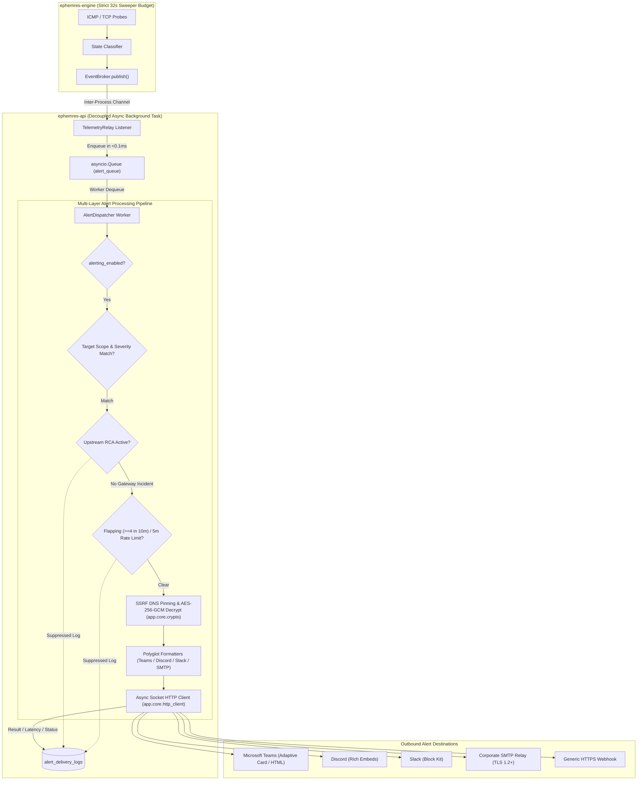

# Ephemres Architecture Overview — Version 3.3.5

Ephemres v3.3.5 is engineered around a **Vertical Integration Architecture** — a decoupled, asynchronous, high-performance monitoring platform built entirely on pure Python Standard Library primitives, native Linux kernel sockets, and TimescaleDB/PostgreSQL storage. 

By replacing 13 third-party runtime frameworks with 12 in-tree standard library engines (`backend/app/core/`), Ephemres achieves sub-second cold starts, microsecond caching latency, complete immunity from C-extension dependency drift, and robust active/passive multi-protocol network observability.

---

## Core System Components

### 1. Data Access & Repository Layer
* **Native Async ORM (`app.core.orm`):** All database interactions are mediated by zero-dependency strongly typed declarative models inheriting from `DeclarativeBase` (`backend/app/models/`). SQL statements are dynamically compiled into dialect-specific parameterized queries and executed directly over `asyncpg` without SQLAlchemy reflection overhead or mapper delay.
* **Repository Pattern:** Hot query paths live in repositories under `backend/app/repositories/` (`BaseRepository`, `EndpointRepository`, `AuthRepository`, `ReportRepository`); other routers and services, such as bandwidth and settings, query through `app.core.orm` directly.
* **SQL-Level Pagination:** Paginated listings (endpoints, events, incidents, alert history) apply `LIMIT`/`OFFSET` in SQL; the CSV export streams with keyset pagination.
* **Native Schema Engine (`app.core.schema`):** API request validation, response serialization, and system configuration parsing are powered by `SchemaModel` without Pydantic Rust binary dependencies.

### 2. Concurrency Sweeper & Timing Budget (The Poller)
* **Cycle Timing Budget (5 pings @ 8.0s):** Each sweep sends `ping_count` probes (default 5) spaced `ping_interval_seconds` apart (default 8.0s), each waiting up to 2.0s for its reply. A sweep typically takes ~32s and at most `count × 2s + (count − 1) × interval` = 42s with the defaults.
* **Cycle Headroom:** The cycle is a fixed 60 seconds. At startup the engine rejects any configured ping plan whose worst-case sweep exceeds 55s (leaving at least 5s for the database write and slot realignment), logs an error, and falls back to 5 pings @ 8.0s.
* **Deterministic Slot Staggering:** Each endpoint is assigned a fixed second within the minute (`UUID mod 60`) and every cycle starts on that slot, so sweeps spread evenly across the minute instead of all firing at once. There is no random jitter.
* **Per-Cycle Probe History (`endpoint_probe_samples` & `endpoint_probe_hourly`):** Each 60-second sweep computes `rtt_min_ms`, `rtt_avg_ms`, `rtt_max_ms`, `jitter_ms`, and `sent`/`received` counts (`PingResult`), writing a row to the `endpoint_probe_samples` hypertable (compressed after 2 days, retained 30 days) with an hourly continuous aggregate `endpoint_probe_hourly` (retained 365 days).
* **Dynamic In-Memory Registry:** `EndpointRegistry` maintains a thread-safe, concurrent registry allowing sub-minute endpoint additions, updates, and removals with zero engine downtime.

### 3. Dual-Driver Storage Architecture
The platform supports pluggable, dual-driver storage via `StorageDriverManager`:
* **PostgreSQL-Native Driver:**
  - `PostgresSessionStore`: Manages authenticated sessions within the `user_sessions` PostgreSQL table.
  - `PostgresEventBroker`: Uses PostgreSQL `LISTEN / NOTIFY` asynchronous channels to publish and broadcast telemetry events.
* **FastStore In-RAM Driver (`app.core.faststore`):**
  - `FastStoreSessionStore`: Caches active sessions in high-speed in-RAM `/dev/shm` SQLite WAL storage with atomic TTL expiry and sub-microsecond access times.
  - `FastStoreEventBroker`: Uses native in-memory Pub/Sub channels for high-throughput, low-latency inter-process messaging.
  - **Zero-Daemon Architecture:** Completely replaces external `redis-server` daemon instances, eliminating Unix domain socket timeouts, socket permission drift, and memory bloat.
* **Multi-Worker Settings & Driver Cluster Synchronization (`SYSTEM_SETTINGS_SYNC`):**
  When running under multiple Uvicorn workers, modifying active storage settings via the Admin UI triggers a PostgreSQL `NOTIFY system_settings_sync` signal. All listening worker processes dynamically reload driver configurations and synchronize active session stores without service downtime or cluster restarts.
* **Bidirectional Warm Session State Migration:**
  When switching active drivers between PostgreSQL and FastStore, active sessions are dynamically read and migrated to the destination backend in real time, guaranteeing zero operator session termination or abrupt logouts.

### 4. Real-Time Telemetry & Server-Sent Events (SSE)
* **Native ASGI 3.0 SSE Stream (`GET /api/v1/events/stream`):** Delivers continuous telemetry directly to web browsers using `text/event-stream` mediated by `EventSourceResponse` in `app.core.asgi`.
* **Structured Event Envelopes:** Emits strongly typed JSON events on every monitoring transition (`STATE_TRANSITION`, `NODE_STATE_CHANGE`, `RCA_INCIDENT`, `ROUTE_CHANGE`).
* **Connection Heartbeat:** Emits a 15-second heartbeat comment (`: heartbeat\n\n`) to keep reverse-proxy connections (Nginx, Traefik, HAProxy) alive.

### 5. Multi-Protocol Synthetic Probes & SSRF Defense
> [!NOTE]
> The probe implementations below exist in `monitoring/synthetic.py` (`run_tcp_probe`, `run_http_probe`, `run_ssl_probe`), but **they are not yet scheduled by `ephemres-engine`, configurable through the API, or shown in the UI**. Endpoint health today is ICMP-only.

* **Synthetic Probes:**
  - `TCP_PORT`: Validates service port reachability and TCP 3-way handshake latency.
  - `HTTP_STATUS`: Validates HTTP/HTTPS response codes and round-trip time.
  - `SSL_EXPIRY`: Inspects remote TLS certificates and computes days until expiration.
* **Probe Target Restrictions:** Probe targets are resolved and the connection is pinned to the validated IP. Loopback (`127.0.0.0/8`, `::1`), link-local and cloud metadata (`169.254.0.0/16`, `fe80::/10`, `fd00:ec2::254`), and `0.0.0.0/8` are rejected. RFC 1918 private addresses are **allowed**, because probing internal appliances is the purpose of synthetic monitoring. (Outbound alert webhooks use the stricter `app.core.http_client` policy, which also rejects private ranges.)

### 6. High-Fidelity Route Diagnostics, NetFlow Route Augmentation & RCA Engine
* **High-Fidelity Traceroute:** Uses `traceroute -n -q 2 -w 3 -m 30 -I` with `CAP_NET_RAW` capability for accurate ICMP route tracing and multi-probe latency parsing.
* **Layer-2 Auto-Bypass:** Automatically skips redundant multi-hop traceroutes for devices located on the same direct Layer-2 subnet broadcast domain.
* **NetFlow Route Augmentation (`flow_path_observations`, `flow_route_changes`, `ROUTE_HINT`):**
  - `ephemres-flowd` decodes IPv4/IPv6 next-hop addresses from NetFlow v5/v9 and IPFIX and records each exporter's forwarding path `(in_if, out_if, next_hop)` per monitored endpoint in `flow_path_observations`.
  - `PathTracker` (`monitoring/flow/path_tracker.py`) tracks the dominant forwarding path per arrival minute. When a new path dominates for `[flow] route_change_minutes` consecutive minutes (default `3`, ignoring multi-path ECMP load-balancing above `[flow] route_ecmp_share`), it records a `flow_route_changes` row and emits a `ROUTE_HINT` event.
  - The leader `ephemres-api` worker's `TelemetryRelay` receives `ROUTE_HINT` and queues a targeted background traceroute for the endpoint (only while `UP` and `enable_scheduled_discovery` is enabled, with a 15-minute per-endpoint cooldown and a 10/minute global cap).
* **Topological RCA (`INFERRED_DOWN` & `flow_evidence`):** When an upstream aggregation node fails, downstream dependent devices are marked `INFERRED_DOWN`, preventing cascading alert storms. Each RCA incident also records a `flow_evidence` JSONB snapshot showing the last observed flow paths, recent route changes, and whether traffic continued flowing after ICMP probes started failing.

### 7. Interactive Crossing-Free Topology Map
* **4-Phase Sugiyama & Gansner Framework**:
  1. **Phase 1: BFS DAG Longest-Path Layering (`Level(v) = max(Level(u) + 1)`)**: Assigns every node to its exact discrete hop depth tier.
  2. **Phase 2: Crossing Reduction (`edgeMinimization: true`)**: Sugiyama barycenter reordering of sibling nodes to eliminate overlapping diagonal links.
  3. **Phase 3: Coordinate Assignment (`blockShifting: true`, `parentCentralization: true`)**: Gansner coordinate alignment centering parents directly over child clusters.
  4. **Phase 4: Directional Spline Routing (`cubicBezier`)**: Tangent-constrained spline channels with Horizontal (`LR`) ⇄ Vertical (`UD`) switching.
* **NetFlow Link Verification (`refresh_flow_status`):** Every 5 minutes (and across topology rebuilds), `TopologyGraphManager` compares baseline traceroute hops against recent `flow_path_observations` (last 15 minutes), annotating edges as `confirmed`, `differs`, or `inferred` (naming silent `* * *` hops via `flow_inferred_ip`).
* **Frozen Physics Real-Time Recoloring:** Updates node state colors in place on SSE `NODE_STATE_CHANGE` events with `physics: { enabled: false }` to prevent canvas shaking.

### 8. Enterprise Alerting Subsystem & Decoupling Invariant
* **Decoupling Invariant:** Outbound webhooks and email notifications can experience unpredictable network delays, TLS handshakes, or third-party API rate limits (100ms – 10s+). Running alert dispatching inside the `ephemres-engine` monitoring sweep would stall raw ICMP socket reading and blow the critical 32-second sweep budget. To preserve deterministic timing, the **Alert Dispatcher operates entirely within the `ephemres-api` service as an independent asynchronous background task pool**.
* **Inter-Process Decoupling Pipeline:**
  1. `ephemres-engine` executes ICMP/TCP probes and publishes transitions to `EventBroker` (`LISTEN/NOTIFY` or FastStore Pub/Sub) in sub-millisecond time.
  2. `TelemetryRelay` running in `ephemres-api` receives the event and enqueues it into an in-memory `asyncio.Queue`.
  3. `AlertDispatcher` pulls from the queue and applies multi-layer filtering:
     - **Scope Filter:** Evaluates target scope (`all` vs. explicit endpoint UUIDs) and severity bitmasks.
     - **RCA Cascade Suppression:** Suppresses individual downstream endpoint notifications when an upstream parent node generates an active `RCA_INCIDENT`.
     - **Flapping & Rate Limits:** An endpoint with $\ge 4$ state transitions in a sliding 10-minute window is treated as flapping: deliveries are skipped and logged as `THROTTLED` until the window drops below 4. Independently, each (channel, endpoint, severity) combination sends at most one alert per 5 minutes.
     - **Cryptographic & SSRF Defense:** Derives AES-256-GCM decryption keys via HKDF-SHA256 (`app.core.crypto`) and validates outbound destination IPs against loopback and cloud metadata ranges using `app.core.http_client`.
     - **Polyglot Formatters:** Adapts payload to Microsoft Teams (Adaptive Cards v1.4 & HTML fallback), Discord (Rich Embeds), Slack (Block Kit), or SMTP TLS 1.2+ MIME.
     - **Delivery Audit Logging:** Persists asynchronous results, HTTP response codes, and round-trip latencies into `alert_delivery_logs`.

### 9. Network Flow Telemetry Ingestion Pipeline (`ephemres-flowd`)
* **Autonomous Ingestion Daemon:** `ephemres-flowd` runs as an independent `systemd` daemon completely isolated from `ephemres-engine` and `ephemres-api`. Even under massive multi-gigabit traffic bursts, ICMP polling and REST API responsiveness remain completely unperturbed.
* **Async Datagram Sockets & Buffer Allocation:** Listens on UDP port 2055 (NetFlow v5/v9) and UDP port 4739 (IPFIX) with a 4MB kernel receive buffer (`SO_RCVBUF = 4 * 1024 * 1024`), eliminating UDP packet drops under high-pps microbursts.
* **Zero-Allocation Binary Decoders:** High-throughput `struct.unpack_from` byte-slice parsers with dynamic template caching (1,800s TTL) for NetFlow v9 and IPFIX options/flow records. Data FlowSets that arrive before their template are buffered per `(exporter, source/observation domain)` in a bounded ring buffer (100 FlowSets, 10-second TTL) and decoded once the template arrives.
* **Dual-Role $\mathcal{O}(1)$ In-Memory Correlator:**
  - Maintains pre-indexed hash maps for sub-microsecond matching without SQL queries.
  - **Exporter Resolution:** Resolves exporter IP against endpoint primary IPs and `flow_exporter_ips` secondary aliases. Unknown exporter IPs are recorded in FastStore (rate-limited to one write per IP every 10 seconds) as a `flow:unmatched:<ip>` key with a 15-minute TTL, a member of `flow:unmatched:set`, and a `flow:unmatched:zset` sorted set pruned to the last 24 hours (capped at 1,000 IPs). These drive the Unmatched Exporter Discovery Banner in the UI.
  - **Traffic Participant Resolution:** Resolves source and destination IPs against monitored inventory endpoints to attribute traffic to internal infrastructure vs. external internet.
* **Port Normalization & Cardinality Shield:** Normalizes ephemeral client ports (1024–65535) unless recognized as well-known server services (e.g. 8080, 8443, 3306, 5432, 6379, 9200) into a single aggregate representation. This prevents high-entropy ephemeral client ports from exploding TimescaleDB hypertable B-tree index sizes.
* **FastStore Stream Shock-Absorber (`stream:netflow:raw`):** Ingested flows are buffered into in-RAM FastStore Streams using `XADD` with sliding window trimming (`MAXLEN ~100000`). A circuit breaker checks FastStore's reported memory use against `[flow] buffer_memory_limit_mb` (default 512 MB); above 85% it drops the pending aggregation buffer and logs an error rather than letting the store grow unbounded.
* **4-Tier Hierarchical Storage Lifecycle:**
  1. *Tier 1 (Real-Time Raw Buffer):* FastStore Stream (`stream:netflow:raw`), sliding 2-hour retention for real-time forensic inspection.
  2. *Tier 2 (1-Minute Rollups):* TimescaleDB hypertable `flow_minute_rollups`, uncompressed for 24 hours, compressed via TimescaleDB columnar compression after 1 day (85%+ disk space reduction), dropped after 90 days by a TimescaleDB retention policy. Per-interface counters live in `flow_interface_minute_rollups` (uncompressed, 7-day retention).
  3. *Tier 3 (Hourly Aggregates):* TimescaleDB continuous aggregate `flow_hourly_rollups` (`materialized_only = false` for real-time tail reads), refreshed every hour, retained for 30 days; plus `flow_interface_hourly_rollups` storing hourly interface byte/packet sums and busiest-minute peaks (`peak_in_minute_bytes`, `peak_out_minute_bytes`), retained for 365 days.
  4. *Tier 4 (Daily Aggregates):* TimescaleDB continuous aggregate `flow_daily_rollups` (`materialized_only = false`), refreshed daily, retained for 365 days for long-term capacity planning.

---

## 10. Layer 0 Core Foundation (Zero-Dependency Engines)

At the bedrock of Ephemres v3.3.5 is **Layer 0 (`backend/app/core/`)** — 12 specialized, zero-dependency engines crafted strictly from the Python Standard Library and native Linux system calls:

| Module | Engine Functionality | Technical Mechanics & Stdlib Primitives |
| :--- | :--- | :--- |
| **`app.core.asgi`** | Native ASGI 3.0 Web Application | Replaces `fastapi` and `starlette`. Implements `EphemresApp`, regex route matching, dependency resolution (`Depends`), query/path/body extraction, CORS middleware, and `EventSourceResponse` SSE streaming. |
| **`app.core.orm`** | Native Async Object-Relational Mapper | Replaces `sqlalchemy`. Pure-stdlib async ORM over `asyncpg`: `DeclarativeBase`, `Column`, SQL type compilation, relationship loading, Unit-of-Work `AsyncSession`, and query compilers (`select`, `insert`, `update`, `delete`, `func`, `case`, `text`, `or_`). |
| **`app.core.schema`** | Pure-Stdlib Type Validation & Serialization | Replaces `pydantic`. Implements `SchemaModel`, `Field`, `validator`, `field_validator`, `model_validator`, `ConfigDict`, and `to_camel` using stdlib `typing`, `inspect`, and `re`. |
| **`app.core.faststore`** | In-RAM High-Performance Cache & Message Bus | Replaces `redis-server` and `redis-py`. Pure-stdlib in-RAM `/dev/shm` SQLite WAL engine with `RLock` isolation. Implements Key-Value with expiry, Sets, Sorted Sets (ZSET), high-throughput Streams (`XADD`, `XREADGROUP`, `XACK`, `XTRIM`), and Pub/Sub. |
| **`app.core.migrator`** | Native Async Database Migration Engine | Replaces `alembic` and `psycopg2-binary`. Direct PostgreSQL DDL compilation executing revisions `0001` through `0017` over `asyncpg`, recording executed versions in the `alembic_version` state table. |
| **`app.core.crypto`** | Secret Encryption Engine | Replaces `cryptography` for secrets at rest. AES-256-GCM encryption of alert-channel credentials (`ENC:v1:` envelope) with pure-Python HKDF-SHA256 key derivation and legacy-salt fallback decryption. The AES-GCM primitive is called through `ctypes` from the system OpenSSL `libcrypto` (already required by Python's `ssl`/`hashlib`); no Python package is involved. Password hashing is separate: scrypt (`hashlib.scrypt`, `$scrypt$n=131072,r=8,p=1$`, constant-time `hmac.compare_digest`) lives in `app.services.auth_service.ScryptPasswordHasher`, replacing `argon2-cffi`. |
| **`app.core.restore`** | Cross-Version Database Backup Restore Engine | Schema-reconciling restore engine reconciling TimescaleDB chunk remapping, missing columns, and password hash upgrades across `v3.1.35s`, `v3.3.0`, `v3.3.1n`, and `v3.3.2v+`. |
| **`app.core.http_client`** | Socket-Level SSRF-Immune HTTP Client | Replaces `httpx`. Asynchronous raw socket HTTP/1.1 client (`asyncio.open_connection`, `ssl`) performing pre-connection DNS validation against RFC 1918, RFC 3927 (cloud metadata `169.254.169.254`), and loopback IPs. |
| **`app.core.netlink`** | Pure Linux Kernel RTNETLINK Engine | Replaces `psutil`. Pure Linux kernel Netlink binary parser (`AF_NETLINK`, `NETLINK_ROUTE`, `RTM_GETADDR`) and `/proc` stat readers for asynchronous interface and system telemetry. |
| **`app.core.pdf`** | Direct PostScript/PDF Binary Emitter | Replaces `weasyprint`, `cairo`, `pango`, and `pypdf`. Generates vector-styled executive compliance reports, tables, typography matrices, and Base64 logos without external shared libraries. |
| **`app.core.template`** | Zero-Dependency Template Compiler | Replaces `jinja2` and `markupsafe`. Supports template inheritance (``, ``), loops, conditionals, and context-aware HTML escaping using pure stdlib regex and AST parsing. |
| **`app.core.watchdog`** | Linux Systemd Watchdog Supervisor | Pure-stdlib `systemd` watchdog notification client using `sd_notify` protocol over Unix domain datagram sockets (`AF_UNIX`). |

Two smaller stdlib helpers live outside `app.core`:
* **X.509 expiry parsing** (`monitoring/synthetic.py`, `_parse_der_cert_not_after`): a minimal ASN.1 DER reader that extracts the certificate `notAfter` date for `SSL_EXPIRY` probes when the TLS handshake is unverified. It replaces `cryptography.x509` for that one purpose and does not parse `notBefore` or Subject Alternative Names.
* **Logging** (`backend/app/logging_config.py`, `setup_logging`): stdlib `logging` with a console handler and size-bounded `RotatingFileHandler`s (10 MB × 5 per service, plus a shared `error.log`), timestamps formatted `%Y-%m-%d %H:%M:%S` in server local time.

---

## Architectural Diagram

```mermaid
flowchart TD
    subgraph UI_Layer["Frontend & UI Layer (Vue 3 / Vite)"]
        A["Dashboard View (KPI Strip & Dual View)"]
        T["Topology Canvas (Frozen Physics)"]
        BW["Bandwidth Dashboard (/bandwidth)"]
        S["Admin Settings Console (/settings)"]
    end

    subgraph SSE_Stream["Real-Time Event Streaming"]
        E_STREAM["Native SSE Stream (/api/v1/events/stream)"]
        A -.->|Subscribes| E_STREAM
        T -.->|Subscribes| E_STREAM
        BW -.->|Subscribes| E_STREAM
    end

    subgraph API_Layer["Native API Service Layer (ephemres-api)"]
        B["Native ASGI 3.0 Engine (EphemresApp)"]
        AUTH["Scrypt & Session Guard (app.services.auth_service)"]
        REPO["Repository Layer (Decoupled Queries)"]
    end

    subgraph Layer0_Core["Layer 0: Zero-Dependency Core Engines (backend/app/core/)"]
        CORE_ASGI["app.core.asgi (ASGI 3.0 & SSE)"]
        CORE_ORM["app.core.orm (Async ORM & Compilers)"]
        CORE_SCHEMA["app.core.schema (SchemaModel Validation)"]
        CORE_FASTSTORE["app.core.faststore (/dev/shm SQLite WAL)"]
        CORE_MIGRATOR["app.core.migrator (Direct asyncpg DDL)"]
        CORE_CRYPTO["app.core.crypto (AES-256-GCM + HKDF)"]
        CORE_HTTP["app.core.http_client (SSRF-Immune Sockets)"]
        CORE_NETLINK["app.core.netlink (RTNETLINK & /proc)"]
        CORE_PDF["app.core.pdf (Direct PDF Vector Emitter)"]
        CORE_TMPL["app.core.template (Jinja2-Compatible)"]
    end

    subgraph Storage_Drivers["Pluggable Storage Drivers"]
        MGR["StorageDriverManager"]
        PS["PostgresSessionStore / PostgresEventBroker"]
        FS["FastStoreSessionStore / FastStoreEventBroker"]
        F_STREAM["FastStore Stream (/dev/shm: stream:netflow:raw)"]
        MGR --> PS
        MGR --> FS
    end

    subgraph Monitoring_Core["Monitoring & Diagnostic Engines (ephemres-engine)"]
        ENG["Monitoring Sweeper (5 pings @ 8s / 28s Headroom)"]
        REG["Dynamic EndpointRegistry"]
        SYN["Synthetic Probes (TCP / HTTP / SSL, not yet scheduled)"]
        TR["High-Fidelity Traceroute & L2 Auto-Bypass"]
        RCA["RCA Topology & Inference Engine"]
    end

    subgraph Flow_Ingestion["Flow Telemetry Ingestion (ephemres-flowd)"]
        FLOWD["Flow Collector Daemon (UDP 2055 / 4739)"]
        CORR["Dual-Role O(1) Correlator"]
        FLOWD --> CORR
        CORR --> F_STREAM
    end

    subgraph Database_Layer["PostgreSQL & TimescaleDB"]
        DB[("PostgreSQL 14+ with TimescaleDB")]
        HT[("Hypertables (Metrics & Flow Rollups)")]
        CAG[("Continuous Aggregates (Hourly & Daily)")]
        DB --> HT
        DB --> CAG
    end

    E_STREAM --> B
    B --> AUTH
    B --> REPO
    REPO --> CORE_ORM
    CORE_ORM --> DB
    B --> MGR
    B --> F_STREAM

    ENG --> REG
    ENG -.->|not yet wired| SYN
    ENG -.->|Triggers on Drop| TR
    TR -.->|Informs| RCA
    ENG --> REPO
    ENG --> MGR

    FLOWD --> REPO
    F_STREAM --> DB
```



---

## Alert Dispatcher Subsystem Diagram



---

## Network Flow Telemetry Ingestion Pipeline Diagram

```mermaid
flowchart TD
    subgraph Network_Exporters["Network Infrastructure (Routers, Switches & Firewalls)"]
        R1["Cisco / Juniper / Mikrotik / pfSense / Linux"]
        R1 -->|NetFlow v5/v9 (UDP 2055)| UDP_2055["UDP Port 2055"]
        R1 -->|IPFIX (UDP 4739)| UDP_4739["UDP Port 4739"]
    end

    subgraph Ingestion_Daemon["Autonomous Daemon: ephemres-flowd"]
        SO_RCV["4MB Kernel Socket Buffer (SO_RCVBUF)"]
        UDP_2055 --> SO_RCV
        UDP_4739 --> SO_RCV

        DECODER["Zero-Allocation Binary Parser (struct.unpack_from)"]
        SO_RCV --> DECODER

        subgraph Parser_Internals["Decoder & Template Engine"]
            TMPL_CACHE["Template Cache (1,800s TTL)"]
            RING_BUF["Orphan Data Set Ring Buffer (100 FlowSets, 10s TTL)"]
            NORM["Ephemeral Port Normalizer (>1024 to single bucket)"]
            DECODER --> TMPL_CACHE
            DECODER --> RING_BUF
            DECODER --> NORM
        end

        subgraph Correlator["Dual-Role In-Memory Correlator (O(1))"]
            EXP_MAP["Exporter Index (Primary IP + flow_exporter_ips)"]
            PART_MAP["Traffic Participant Index (Monitored Endpoints)"]
            UNMATCHED["FastStore: flow:unmatched:* (15m keys, 24h zset)"]
            
            NORM --> EXP_MAP
            NORM --> PART_MAP
            EXP_MAP -.->|Unmapped IP| UNMATCHED
        end

        CIRCUIT["Circuit Breaker (>85% of buffer_memory_limit_mb)"]
        NORM --> CIRCUIT
    end

    subgraph Storage_Tiers["4-Tier Hierarchical Storage Lifecycle"]
        CIRCUIT -->|XADD (MAXLEN ~100k)| TIER1["Tier 1: FastStore In-RAM Stream (/dev/shm, 2h TTL)"]
        
        TIER1 -->|Rollup Worker (60s Batch)| TIER2["Tier 2: TimescaleDB flow_minute_rollups (90d Retention)"]
        TIER2 -.->|After 1 Day| TIER2_COMP["TimescaleDB Columnar Compression (85%+ Savings)"]
        
        TIER2 -->|Continuous Aggregate| TIER3["Tier 3: flow_hourly_rollups (30d Retention)"]
        TIER3 -->|Continuous Aggregate| TIER4["Tier 4: flow_daily_rollups (365d Retention)"]
    end

    subgraph UI_API["Operator Presentation Layer"]
        API["Native Bandwidth Router (/api/v1/bandwidth/*)"]
        TIER1 -.->|Forensic Top-Talkers| API
        TIER2 -->|Traffic Series & App Mix| API
        TIER3 -->|Multi-Day Trends| API
        TIER4 -->|Annual Capacity Planning| API
        UNMATCHED -.->|Discovery Banner| API

        DASH["Bandwidth Dashboard (/bandwidth)"]
        EP_TAB["Endpoint Detail (Flow Telemetry Tab)"]
        API --> DASH
        API --> EP_TAB
    end
```
