# Ephemres Database & TimescaleDB Architecture — Version 3.3.5

This document details the PostgreSQL 14+ schema design, TimescaleDB hypertable partitioning, continuous aggregates, columnar compression policies, and 4-tier lifecycle in Ephemres v3.3.5.

---

## 1. Relational Schema Architecture

```mermaid
erDiagram
    endpoints ||--o{ endpoint_events : "records state periods (Hypertable)"
    endpoints ||--o{ endpoint_probe_samples : "records per-cycle RTT/loss (Hypertable)"
    endpoints ||--o{ endpoint_baseline_routes : "stores baseline traceroute"
    endpoints ||--o{ endpoint_diagnostic_traces : "stores ephemeral JSONB traces"
    endpoints ||--o{ endpoint_rca_incidents : "tracks root cause outages"
    endpoints ||--o{ flow_minute_rollups : "attributes traffic (Hypertable)"
    endpoints ||--o{ flow_interface_minute_rollups : "attributes interface traffic (Hypertable)"
    endpoints ||--o{ flow_path_observations : "tracks flow forwarding paths"
    endpoints ||--o{ flow_route_changes : "records dominant path changes"
    alert_channels ||--o{ alert_delivery_logs : "records dispatch audit"
    users ||--o{ user_sessions : "maintains active sessions"
    users ||--o{ audit_logs : "records admin actions"
```



---

## 2. Table Specifications

### `endpoints`
Stores network monitoring targets, IP addresses, operational flags, and multi-IP flow exporter mappings.
* `id` (`UUID`, Primary Key)
* `hostname` (`VARCHAR(255)`, Not Null)
* `ip_address` (`INET`, Unique, Not Null)
* `device_type` (`VARCHAR(100)`, Not Null: `ROUTER`, `SWITCH`, `SERVER`, `GATEWAY`, `ENDPOINT`, etc.)
* `device_role` (`VARCHAR(30)`, Default: `'ACTIVE_HOST'`, Not Null) — Monitoring/flow role, enforced by check constraint `ck_endpoints_device_role`: `ACTIVE_HOST` (ICMP-monitored host), `FLOW_EXPORTER` (passive flow exporter, not pinged), `HYBRID_GATEWAY` (monitored and exporting flows), `L2_SWITCH`. Cross-version restores map legacy names (`STANDARD`, `ROOT_GATEWAY`, `AGGREGATION`, `EDGE_ROUTER`, `CORE_SWITCH`, `ACCESS`, …) onto these four.
* `location` (`VARCHAR(255)`, Nullable)
* `description` (`TEXT`, Nullable)
* `monitoring_enabled` (`BOOLEAN`, Default: `true`, Not Null)
* `endpoint_status` (`VARCHAR(20)`, Default: `'ACTIVE'`, Not Null)
* `allow_incident_trace` (`BOOLEAN`, Default: `true`, Not Null)
* `allow_topology_discovery` (`BOOLEAN`, Default: `true`, Not Null)
* `enable_rca` (`BOOLEAN`, Default: `true`, Not Null)
* `enable_scheduled_discovery` (`BOOLEAN`, Default: `true`, Not Null)
* `is_l2_segment` (`BOOLEAN`, Default: `false`, Not Null)
* `manual_parent_id` (`UUID`, Foreign Key to `endpoints.id` `ON DELETE SET NULL`, Nullable)
* `created_by` (`UUID`, Foreign Key to `users.id`, Nullable)
* `created_at` / `updated_at` (`TIMESTAMPTZ`, Default: `now()`, Not Null) and `deleted_at` (`TIMESTAMPTZ`, Nullable; soft delete)
* `flow_exporter_ips` (`INET[]`, Default: `'{}'::inet[]`, Not Null) — Secondary exporter IP addresses aliased to this endpoint. Indexed via GIN index `idx_endpoints_flow_exporter_ips` for high-speed array containment queries (`flow_exporter_ips @> ARRAY['192.168.1.1'::inet]`).
* `flow_interface_aliases` (`JSONB`, Default: `'{}'::jsonb`, Not Null) — Key-value dictionary mapping SNMP interface indexes (`ifIndex`) to human-readable labels, provisioned speeds (optional/`null` when unset), and link roles (`"wan"` or `"lan"`, default `"lan"`), e.g. `{"1": {"name": "WAN-Fiber", "speed_mbps": 1000, "role": "wan"}}`.

### `endpoint_probe_samples` (TimescaleDB Hypertable — Migration `0015`)
Stores per-cycle ICMP sweep metrics (one row per monitored endpoint per 60-second sweep cycle).
* `endpoint_id` (`UUID`, Primary Key, Foreign Key to `endpoints.id` `ON DELETE CASCADE`, Not Null)
* `sampled_at` (`TIMESTAMPTZ`, Primary Key, Partition Key, Not Null)
* `sent` (`SMALLINT`, Not Null) — Probes transmitted in the sweep cycle.
* `received` (`SMALLINT`, Not Null) — Replies received in the sweep cycle.
* `rtt_min_ms` / `rtt_avg_ms` / `rtt_max_ms` (`REAL`, Nullable) — Minimum, arithmetic mean, and maximum RTT (ms) across received replies (`NULL` when `received = 0`).
* `jitter_ms` (`REAL`, Nullable) — Mean absolute consecutive RTT difference across received replies.
* *Policies*: 1-day chunk interval, columnar compression after 7 days (`compress_segmentby = 'endpoint_id'`, `compress_orderby = 'sampled_at DESC'`), 30-day retention policy. Rolled up into `endpoint_probe_hourly` (continuous aggregate with `materialized_only = false`, 365-day retention).

### `flow_path_observations` & `flow_route_changes` (Migration `0017`)
Track forwarding paths observed in NetFlow/IPFIX records to and from monitored endpoints:
* **`flow_path_observations`**:
  - `exporter_id` (`UUID`, Foreign Key to `endpoints.id` `ON DELETE CASCADE`, Not Null)
  - `endpoint_id` (`UUID`, Foreign Key to `endpoints.id` `ON DELETE CASCADE`, Not Null)
  - `direction` (`VARCHAR(4)`, Not Null: `'to'` or `'from'`)
  - `in_if` / `out_if` (`INTEGER`, Not Null) — Input and output SNMP interface indices.
  - `next_hop` (`INET`, Nullable) — Forwarding next-hop router IP (`NULL` when `0.0.0.0`/`::` or not exported).
  - `first_seen` / `last_seen` (`TIMESTAMPTZ`, Not Null)
  - `bytes` (`BIGINT`, Not Null) and `flow_count` (`BIGINT`, Not Null)
  - Indexed via unique expression index `uq_flow_path_observations_key` on `(exporter_id, endpoint_id, direction, in_if, out_if, COALESCE(next_hop, '0.0.0.0'::inet))`. Pruned after 30 days of inactivity.
* **`flow_route_changes`**:
  - Records sustained dominant path shifts (`detected_at`, `exporter_id`, `endpoint_id`, `direction`, `old_out_if`, `old_next_hop`, `new_out_if`, `new_next_hop`, `sample_minutes`). Retained for 90 days.
* **`endpoint_rca_incidents.flow_evidence`** (`JSONB`, Nullable):
  - Stores flow path and route-change evidence alongside RCA incidents (`paths`, `route_changes`, `traffic_after_failure`, `summary`).

### `endpoint_events` (TimescaleDB Hypertable)
Stores state periods: one row per confirmed state, extended while the state persists (`end_time`, `duration_seconds`, `monitoring_cycle_count`) and closed when the state changes.
* `id` (`UUID`, Default: `gen_random_uuid()`, Not Null)
* `endpoint_id` (`UUID`, Foreign Key to `endpoints.id`, Not Null)
* `operational_state` (`VARCHAR(20)`, Not Null: `UP`, `DOWN`)
* `detailed_state` (`VARCHAR(30)`, Not Null: `UP`, `UP-UNSTABLE`, `DOWN-UNSTABLE`, `DOWN`)
* `success_count` / `failed_count` (`SMALLINT`, Not Null) — Replies received / probes lost in the most recent cycle.
* `health_score` (`NUMERIC(5, 2)`, Not Null) — `success_count / total × 100`.
* `avg_rtt_ms` (`NUMERIC(10, 2)`, Nullable) — Mean RTT of received replies.
* `is_split_event` (`BOOLEAN`, Default: `false`, Not Null) — Row created by splitting a long-running period (e.g. at the 24-hour rollover).
* `start_time` (`TIMESTAMPTZ`, Primary Key, Partition Key, Not Null)
* `end_time` (`TIMESTAMPTZ`, Nullable — `NULL` while the period is open)
* `duration_seconds` (`BIGINT`, Nullable)
* `monitoring_cycle_count` (`INTEGER`, Default: `1`, Not Null) — Cycles aggregated into this period.
* `created_at` (`TIMESTAMPTZ`, Default: `now()`, Not Null)

### `flow_minute_rollups` (TimescaleDB Hypertable)
Stores 1-minute aggregated passive flow metrics ingested via NetFlow v5, NetFlow v9, and IPFIX.
* `bucket` (`TIMESTAMPTZ`, Primary Key, Partition Key, Not Null) — 1-minute time boundary.
* `exporter_id` (`UUID`, Primary Key, Not Null) — Associated endpoint UUID (`00000000-0000-0000-0000-000000000000` for unmapped/orphan flows).
* `src_endpoint_id` (`UUID`, Nullable) — UUID of the source endpoint if matched in inventory.
* `dst_endpoint_id` (`UUID`, Nullable) — UUID of the destination endpoint if matched in inventory.
* `src_ip` (`INET`, Primary Key, Not Null) — Flow source IP address.
* `dst_ip` (`INET`, Primary Key, Not Null) — Flow destination IP address.
* `protocol` (`SMALLINT`, Primary Key, Not Null) — IANA IP protocol number (e.g. 6 = TCP, 17 = UDP, 1 = ICMP).
* `dst_port` (`INTEGER`, Primary Key, Not Null) — Destination port normalized to prevent unbounded index cardinality.
* `bytes` (`BIGINT`, Default: 0, Not Null) — Total bytes transferred in the 1-minute window.
* `packets` (`BIGINT`, Default: 0, Not Null) — Total packets transferred.
* `flow_count` (`INTEGER`, Default: 1, Not Null) — Number of discrete flow records aggregated into this rollup.
* `tcp_flags` (`SMALLINT`, Default: 0, Not Null) — Bitwise OR of the TCP flags seen across the aggregated flows (migration `0013`).
* `tos` (`SMALLINT`, Default: 0, Not Null) — Highest IP ToS/DSCP byte seen (migration `0013`). Migration `0013` also tries to add both columns to `flow_hourly_rollups` and `flow_daily_rollups`, but on TimescaleDB those are continuous aggregates (see §5), which cannot be altered this way, so the columns exist there only on installs without TimescaleDB.
* *Indexes*:
  - `idx_flow_minute_src_dst_endpoint` (`bucket`, `src_endpoint_id`, `dst_endpoint_id`)
  - `idx_flow_minute_exporter_bucket` (`exporter_id`, `bucket`)

### `flow_interface_minute_rollups` (TimescaleDB Hypertable)
Stores 1-minute directional ingress and egress interface-level traffic metrics indexed by SNMP interface index (`ifIndex`).
* `bucket` (`TIMESTAMPTZ`, Primary Key, Partition Key, Not Null) — 1-minute time bucket boundary (UTC).
* `exporter_id` (`UUID`, Primary Key, Not Null) — Associated exporter endpoint UUID.
* `interface_idx` (`INTEGER`, Primary Key, Not Null) — SNMP interface index (`ifIndex`).
* `in_bytes` (`BIGINT`, Default: 0, Not Null) — Directional ingress byte counter.
* `in_packets` (`BIGINT`, Default: 0, Not Null) — Directional ingress packet counter.
* `out_bytes` (`BIGINT`, Default: 0, Not Null) — Directional egress byte counter.
* `out_packets` (`BIGINT`, Default: 0, Not Null) — Directional egress packet counter.
* `flow_count` (`INTEGER`, Default: 0, Not Null) — Number of discrete flow records evaluated for this interface.
* *Indexes & Policies*:
  - Primary key: `(bucket, exporter_id, interface_idx)`
  - Daily chunk interval with 7-day retention policy (migration `0012`).
  - No columnar compression policy is configured on this table.

### `alert_channels`
Stores notification destinations and credentials with AES-256-GCM encryption.
* `id` (`UUID`, Primary Key)
* `name` (`VARCHAR(100)`, Not Null)
* `channel_type` (`VARCHAR(50)`: `TEAMS`, `DISCORD`, `SLACK`, `EMAIL_SMTP`, `GENERIC_WEBHOOK`)
* `is_enabled` (`BOOLEAN`, Default: `true`, Not Null)
* `config` (`TEXT`, Not Null) — AES-256-GCM encrypted JSON payload containing webhook URLs, SMTP passwords, tokens, etc.
* `endpoint_ids` (`JSONB`, Default: `'[]'::jsonb`, Not Null) — Target endpoint UUID filtering (empty list indicates all fleet endpoints).
* `subnet_filters` (`JSONB`, Default: `'[]'::jsonb`, Not Null) — Subnet CIDR filtering (e.g. `["10.0.0.0/24"]`).
* `severity_filters` (`JSONB`, Default: `'["DOWN", "RECOVERED"]'::jsonb`, Not Null) — Severity states triggering alert dispatch.
* `created_at` (`TIMESTAMPTZ`, Default: `now()`, Not Null)
* `updated_at` (`TIMESTAMPTZ`, Default: `now()`, Not Null)

### `alert_delivery_logs`
Audit log of all outbound dispatch attempts.
* `id` (`UUID`, Primary Key)
* `channel_id` (`UUID`, Foreign Key to `alert_channels.id` `ON DELETE CASCADE`, Not Null, Indexed)
* `channel_name` (`VARCHAR(100)`, Not Null) — Snapshot of the channel name at dispatch time.
* `endpoint_id` (`UUID`, Nullable, Indexed) and `endpoint_name` (`VARCHAR(100)`, Not Null)
* `event_type` (`VARCHAR(50)`, Not Null)
* `status` (`VARCHAR(20)`, Not Null: `DELIVERED`, `FAILED`, `THROTTLED`)
* `status_code` (`INTEGER`, Nullable) — HTTP status (or SMTP outcome) returned by the destination.
* `retry_count` (`INTEGER`, Default: 0, Not Null)
* `response_message` (`TEXT`, Nullable) — Truncated response body or error detail.
* `latency_ms` (`INTEGER`, Nullable)
* `timestamp` (`TIMESTAMPTZ`, Default: `now()`, Not Null, Indexed)

---

## 3. 4-Tier Hierarchical Storage Lifecycle

To deliver real-time sub-second forensic drill-down while keeping long-term disk growth bounded, flow telemetry is stored across 4 tiered stages:

| Tier | Storage Engine | Retention | Granularity | Compression / Aggregation | Use Case |
| :--- | :--- | :--- | :--- | :--- | :--- |
| **Tier 1** | FastStore Shared-Memory Stream (`stream:netflow:raw` in `/dev/shm`) | 2 Hours | Flow Record | Sliding in-memory buffer (`MAXLEN ~100000`) | Real-time forensic packet/flow inspection, live anomaly triage. |
| **Tier 2** | TimescaleDB Hypertable (`flow_minute_rollups` / `flow_interface_minute_rollups`) | 90 Days / 7 Days | 1 Minute | `flow_minute_rollups`: native columnar compression after 1 day (85%+ disk savings). `flow_interface_minute_rollups`: uncompressed | Short-term forensic queries, detailed talker attribution, interface throughput. |
| **Tier 3** | TimescaleDB Continuous Aggregate (`flow_hourly_rollups`, `flow_interface_hourly_rollups`, `endpoint_probe_hourly`) | 30 Days / 365 Days | 1 Hour | Materialized Views with `materialized_only = false` and auto-refresh policies | Weekly / monthly capacity trends, 30-day interface p95/peak utilization, and long-term probe RTT/loss trends. |
| **Tier 4** | TimescaleDB Continuous Aggregate (`flow_daily_rollups`) | 365 Days | 1 Day | Materialized View (`materialized_only = false`) with auto-refresh policy (`start_offset: 7d`, `end_offset: 1d`) | Annual capacity planning, ISP billing auditing, executive reporting. |

---

## 4. TimescaleDB Columnar Compression & Retention Policies

### A. Telemetry Events Compression & Retention
```sql
ALTER TABLE endpoint_events SET (
    timescaledb.compress,
    timescaledb.compress_segmentby = 'endpoint_id',
    timescaledb.compress_orderby = 'start_time DESC'
);

SELECT add_compression_policy('endpoint_events', INTERVAL '7 days', if_not_exists => true);
SELECT add_retention_policy('endpoint_events', INTERVAL '730 days', if_not_exists => true);
```
Migration `0010` installs the 730-day retention policy. At startup, `ephemres-engine` aligns it with `[monitoring] retention_days` in `/etc/ephemres/config.toml` (default `730`, allowed range 30–3650), replacing the policy only when the value differs.

> [!WARNING]
> Lowering `retention_days` makes TimescaleDB drop `endpoint_events` chunks older than the new window at the next policy run. Those SLA and state-transition records cannot be recovered without a backup.

### B. Flow Minute Rollups Compression & Retention
`flow_minute_rollups` is chunked in 1-day intervals. After 1 day, chunks are converted to TimescaleDB's hybrid columnar format, yielding over **85% disk space savings**:
```sql
-- Convert to hypertable with 1-day chunk interval
SELECT create_hypertable(
    'flow_minute_rollups',
    'bucket',
    chunk_time_interval => INTERVAL '1 day',
    if_not_exists => TRUE
);

-- Columnar compression segmenting by exporter, protocol, and port
ALTER TABLE flow_minute_rollups SET (
    timescaledb.compress,
    timescaledb.compress_segmentby = 'exporter_id, protocol, dst_port',
    timescaledb.compress_orderby = 'bucket DESC'
);

-- Compress chunks older than 24 hours
SELECT add_compression_policy('flow_minute_rollups', INTERVAL '1 day', if_not_exists => TRUE);

-- Automatically purge raw minute rollups after 90 days (migration 0010; 0008 originally set 7 days)
SELECT add_retention_policy('flow_minute_rollups', INTERVAL '90 days', if_not_exists => TRUE);
```

---

## 5. Continuous Aggregates & Baseline Repair

### Hourly Flow Continuous Aggregate (`flow_hourly_rollups`)
Pre-aggregates 60 1-minute samples into 1-hour windows:
```sql
CREATE MATERIALIZED VIEW flow_hourly_rollups
WITH (timescaledb.continuous) AS
SELECT
    time_bucket('1 hour', bucket) AS bucket,
    exporter_id,
    src_endpoint_id,
    dst_endpoint_id,
    protocol,
    dst_port,
    SUM(bytes)::BIGINT AS bytes,
    SUM(packets)::BIGINT AS packets,
    SUM(flow_count)::INTEGER AS flow_count
FROM flow_minute_rollups
GROUP BY time_bucket('1 hour', bucket), exporter_id, src_endpoint_id, dst_endpoint_id, protocol, dst_port
WITH NO DATA;

SELECT add_continuous_aggregate_policy(
    'flow_hourly_rollups',
    start_offset => INTERVAL '3 days',
    end_offset => INTERVAL '1 hour',
    schedule_interval => INTERVAL '1 hour',
    if_not_exists => TRUE
);

SELECT add_retention_policy('flow_hourly_rollups', INTERVAL '30 days', if_not_exists => TRUE);
```

### Daily Flow Continuous Aggregate (`flow_daily_rollups`)
Rolls up traffic into daily totals by exporter, protocol, and service port:
```sql
CREATE MATERIALIZED VIEW flow_daily_rollups
WITH (timescaledb.continuous) AS
SELECT
    time_bucket('1 day', bucket) AS bucket,
    exporter_id,
    protocol,
    dst_port,
    SUM(bytes)::BIGINT AS bytes,
    SUM(packets)::BIGINT AS packets,
    SUM(flow_count)::INTEGER AS flow_count
FROM flow_minute_rollups
GROUP BY time_bucket('1 day', bucket), exporter_id, protocol, dst_port
WITH NO DATA;

SELECT add_continuous_aggregate_policy(
    'flow_daily_rollups',
    start_offset => INTERVAL '7 days',
    end_offset => INTERVAL '1 day',
    schedule_interval => INTERVAL '1 day',
    if_not_exists => TRUE
);

SELECT add_retention_policy('flow_daily_rollups', INTERVAL '365 days', if_not_exists => TRUE);
```
Migration `0014` sets `timescaledb.materialized_only = false` on both `flow_hourly_rollups` and `flow_daily_rollups` so queries over `24h`, `7d`, and `30d` windows automatically merge the newest unmaterialized minutes from `flow_minute_rollups`.

### Hourly Interface Continuous Aggregate (`flow_interface_hourly_rollups` — Migration `0016`)
Pre-aggregates per-interface minute rollups into 1-hour windows while retaining the busiest single minute (`in_peak_bytes`, `out_peak_bytes`) for accurate peak utilization over 30-day windows (retained 365 days, `materialized_only = false`).

### Hourly Probe Continuous Aggregate (`endpoint_probe_hourly` — Migration `0015`)
Pre-aggregates `endpoint_probe_samples` into 1-hour buckets (`sample_count`, `sent`, `received`, `rtt_min_ms`, reply-weighted `rtt_sum_ms`/`rtt_weight`, `rtt_max_ms`, `jitter_avg_ms`), retained for 365 days (`materialized_only = false`).

### Historical Baseline View (`node_historical_baselines`)
TimescaleDB continuous aggregates must group by `time_bucket()` on the partition column and cannot contain non-monotonic expressions such as `EXTRACT(dow FROM start_time)`. Migration `0009` therefore builds the 168-slot (day-of-week × hour) latency profile in two layers when TimescaleDB is available:

```sql
-- 1. Continuous aggregate: hourly RTT statistics per endpoint
CREATE MATERIALIZED VIEW node_historical_baselines_cagg
WITH (timescaledb.continuous) AS
SELECT
    endpoint_id,
    time_bucket('1 hour', start_time) AS bucket,
    AVG(avg_rtt_ms)::FLOAT AS hourly_mean,
    STDDEV(avg_rtt_ms)::FLOAT AS hourly_stddev
FROM endpoint_events
WHERE avg_rtt_ms IS NOT NULL
GROUP BY endpoint_id, time_bucket('1 hour', start_time)
WITH NO DATA;

SELECT add_continuous_aggregate_policy(
    'node_historical_baselines_cagg',
    start_offset => INTERVAL '28 days',
    end_offset => INTERVAL '1 hour',
    schedule_interval => INTERVAL '1 hour',
    if_not_exists => TRUE
);

-- 2. Plain view folding the hourly buckets into the weekly profile read by baseline_service.py
CREATE OR REPLACE VIEW node_historical_baselines AS
SELECT
    endpoint_id,
    EXTRACT(dow FROM bucket)::INTEGER AS day_of_week,
    EXTRACT(hour FROM bucket)::INTEGER AS hour_of_day,
    AVG(hourly_mean)::FLOAT AS historical_mean,
    AVG(hourly_stddev)::FLOAT AS historical_stddev
FROM node_historical_baselines_cagg
GROUP BY endpoint_id, EXTRACT(dow FROM bucket), EXTRACT(hour FROM bucket);
```

Without TimescaleDB (or if creating the continuous aggregate fails), `node_historical_baselines` is instead a plain view computing the same columns directly from `endpoint_events`. Either way, `baseline_service.py` reads the same schema, and the engine uses `historical_mean` / `historical_stddev` for the `μ + 3σ` latency check described in [SLA Calculation Methodology](sla-calculation.md).
