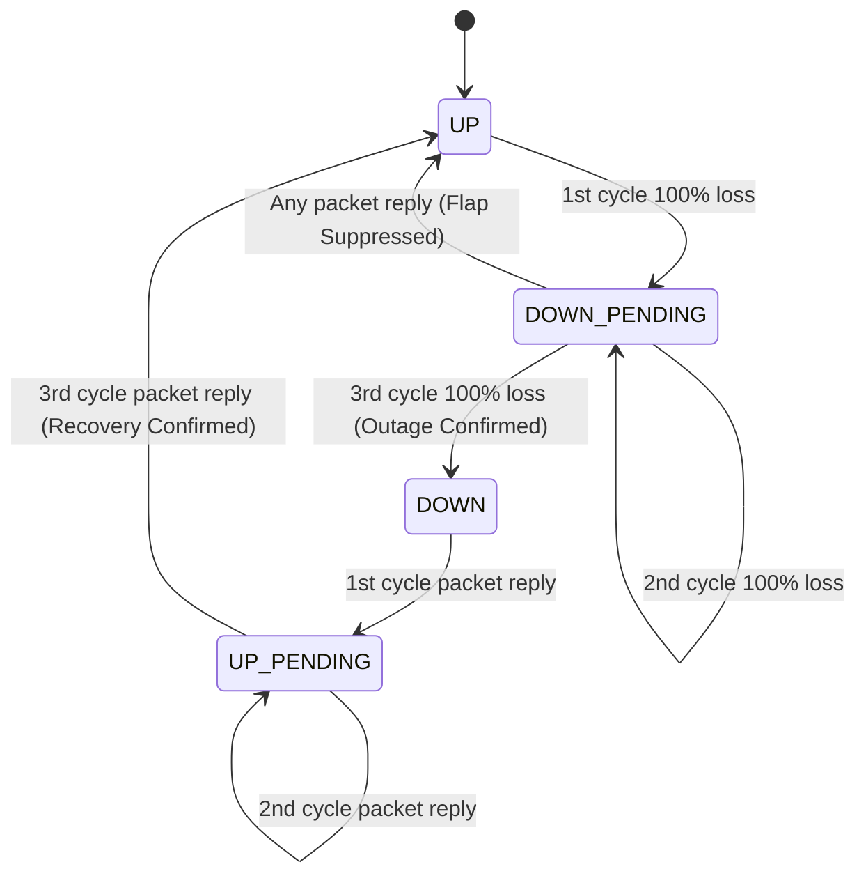

# Ephemres SLA Calculation & Availability Methodology

This document outlines the mathematical principles, state machine transitions, and outage neutralization formulas used by Ephemres to calculate Service Level Agreement (SLA) uptime.

---

## 1. High-Precision Polling Architecture
Traditional monitoring tools send a single ICMP Echo Request every 60 seconds. In that model, a single dropped packet due to transient congestion falsely records a full minute of downtime (a 1.67% SLA penalty over an hour).

Ephemres eliminates false-positive SLA penalties through **5-Ping Sub-Cycle Burst Sweeping**:
* **1-Minute Master Cycle**: Every monitored endpoint is evaluated once per 60-second window.
* **5-Ping Sub-Cycle Sweep**: Within each 60-second window, the `ephemres-ping` engine dispatches **5 ICMP Echo Requests** spaced **8.0 seconds apart** (`~32s` active sweep window + `28s` cycle headroom, 3000ms per-packet timeout).
* **Metrics Captured per Cycle**:
  * `packets_sent`: `5`
  * `packets_lost`: `0` to `5`
  * `loss_pct`: `(packets_lost / 5) * 100.0`
  * `avg_latency_ms`: Arithmetic mean of all received replies in the 5-ping burst.
  * `jitter_ms`: Mean absolute deviation between consecutive RTT samples in the burst.

---

## 2. Four-State Classification Matrix
At the conclusion of each 5-ping cycle, `classify_ping_state()` (`backend/app/monitoring/ping.py`) classifies the endpoint into one of four operational states:

| Operational State | Packets Lost (out of 5) | Packet Loss % | SLA Availability Credit | Operational Meaning |
| :--- | :--- | :--- | :--- | :--- |
| **`UP`** | `0` | `0%` | **Counted as Available (`1.0`)** | Healthy link; zero packet loss. |
| **`UP-UNSTABLE`** | `1 – 2` | `20% – 40%` | **Counted as Available (`1.0`)** | Link is reachable and passing traffic, but experiencing minor congestion or jitter. Triggers early warning visibility without penalizing contractual uptime SLA. |
| **`DOWN-UNSTABLE`** | `3 – 4` | `60% – 80%` | **Counted as Unavailable (`0.0`)** | Severe packet loss rendering synchronous protocols unusable. Triggers degradation alerting and deducts from SLA availability. |
| **`DOWN`** | `5` | `100%` | **Counted as Unavailable (`0.0`)** | Complete loss of reachability across the entire 32-second sweep window. Triggers critical outage alerting. |

---

## 3. In-Memory Flap Suppression (N=3)

State transitions require **3 consecutive cycles (180 seconds)** of sustained condition before the operational state switches from `UP` to `DOWN` or `DOWN` to `UP`:



---

## 4. Honest SLA Mathematics & Blackout Neutralization

### The Problem with Traditional SLA Calculators
If the monitoring server itself loses power or undergoes scheduled maintenance, traditional monitoring tools record the missing intervals as "outages" for all monitored clients, skewing SLA reports.

### The Ephemres Blackout Neutralization Formula
Ephemres computes availability exclusively over monitored lifetime intervals:

```
SLA Availability (%) = [ T_online / (T_monitored_lifetime - T_blackout_neutralized) ] * 100
```

Where:
* `T_online`: Cumulative minutes where `operational_state = 'UP'`.
* `T_monitored_lifetime`: Total elapsed minutes since the endpoint was onboarded.
* `T_blackout_neutralized`: Server downtime or excluded maintenance periods during which the monitoring engine was offline.

This guarantees mathematically sound SLA compliance reports for client reporting, audits, and executive reviews.
