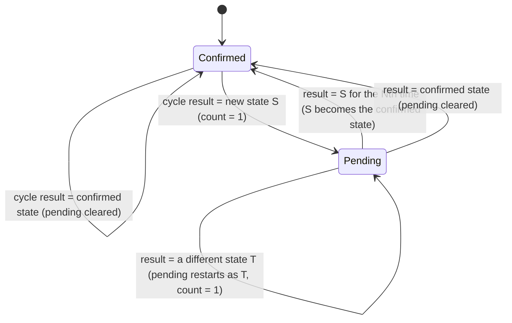

# Ephemres SLA Calculation & Availability Methodology

This document outlines the mathematical principles, state machine transitions, and outage neutralization formulas used by Ephemres to calculate Service Level Agreement (SLA) uptime.

---

## 1. High-Precision Polling Architecture
Traditional monitoring tools send a single ICMP Echo Request every 60 seconds. In that model, a single dropped packet due to transient congestion falsely records a full minute of downtime (a 1.67% SLA penalty over an hour).

Ephemres eliminates false-positive SLA penalties through **5-Ping Sub-Cycle Burst Sweeping**:
* **1-Minute Master Cycle**: Every monitored endpoint is evaluated once per 60-second window.
* **5-Ping Sub-Cycle Sweep**: Within each 60-second window, `ephemres-engine` (`monitoring/engine.py`) dispatches **5 ICMP Echo Requests** spaced **8.0 seconds apart**, each with a **2.0-second reply timeout** (~32s typical, 42s worst case). Count and spacing come from `[monitoring] ping_count` / `ping_interval_seconds`.
* **Metrics Captured per Cycle** (`PingResult` in `monitoring/ping.py`, stored on `endpoint_events`):
  * `success_count`: replies received (`0` to `5`)
  * `failed_count`: probes without a reply
  * `avg_rtt_ms`: arithmetic mean RTT of the received replies (`NULL` when none)
  * `health_score`: `success_count / (success_count + failed_count) × 100`

---

## 2. Four-State Classification Matrix
At the conclusion of each 5-ping cycle, `classify_ping_result()` (`monitoring/ping.py`) returns an operational state (`UP` / `DOWN`) and one of four detailed states. Loss sets the state; when all 5 replies arrive, latency is also checked against the endpoint's hour-of-week baseline:

| Operational State | Packets Lost (out of 5) | Packet Loss % | SLA Availability Credit | Operational Meaning |
| :--- | :--- | :--- | :--- | :--- |
| **`UP`** | `0` | `0%` | **Counted as Available (`1.0`)** | Healthy link: zero packet loss and average RTT within `μ + 3σ` of the baseline (σ floored at 2 ms). |
| **`UP-UNSTABLE`** | `1 – 2`, or `0` with RTT `> μ + 3σ` | `0% – 40%` | **Counted as Available (`1.0`)** | Link is reachable and passing traffic, but experiencing minor loss or abnormal latency. Triggers early warning visibility without penalizing contractual uptime SLA. |
| **`DOWN-UNSTABLE`** | `3 – 4` | `60% – 80%` | **Counted as Unavailable (`0.0`)** | Severe packet loss rendering synchronous protocols unusable. Triggers degradation alerting and deducts from SLA availability. |
| **`DOWN`** | `5` | `100%` | **Counted as Unavailable (`0.0`)** | Complete loss of reachability across the entire sweep. Triggers critical outage alerting. |

---

## 3. In-Memory Flap Suppression (N=3)

State changes are confirmed on the **detailed** state (`UP`, `UP-UNSTABLE`, `DOWN-UNSTABLE`, `DOWN`), not just UP/DOWN. A new detailed state must be observed for **N consecutive cycles** (`[monitoring] state_confirmation_cycles`, default 3, i.e. ~3 minutes) before it replaces the confirmed state:



Consequences worth knowing:
* A single good cycle during an outage (or a single bad cycle while healthy) resets the count, so brief flaps never change the recorded state.
* Because confirmation compares detailed states, an endpoint alternating between `DOWN` and `DOWN-UNSTABLE` restarts the count every cycle and stays in its previous confirmed state until one of them repeats N times.
* A brand-new endpoint has no confirmed state yet: its first cycle result is recorded directly as the initial state.

---

## 4. Honest SLA Mathematics & Blackout Neutralization

### The Problem with Traditional SLA Calculators
If the monitoring server itself loses power or undergoes scheduled maintenance, traditional monitoring tools record the missing intervals as "outages" for all monitored clients, skewing SLA reports.

### The Ephemres Blackout Neutralization Formula
Ephemres computes availability exclusively over monitored lifetime intervals:

```
SLA Availability (%) = [ T_online / (T_monitored_lifetime - T_blackout_neutralized) ] * 100
```

Where:
* `T_online`: Cumulative minutes where `operational_state = 'UP'`.
* `T_monitored_lifetime`: Total elapsed minutes since the endpoint was onboarded.
* `T_blackout_neutralized`: Server downtime or excluded maintenance periods during which the monitoring engine was offline.

This guarantees mathematically sound SLA compliance reports for client reporting, audits, and executive reviews.
